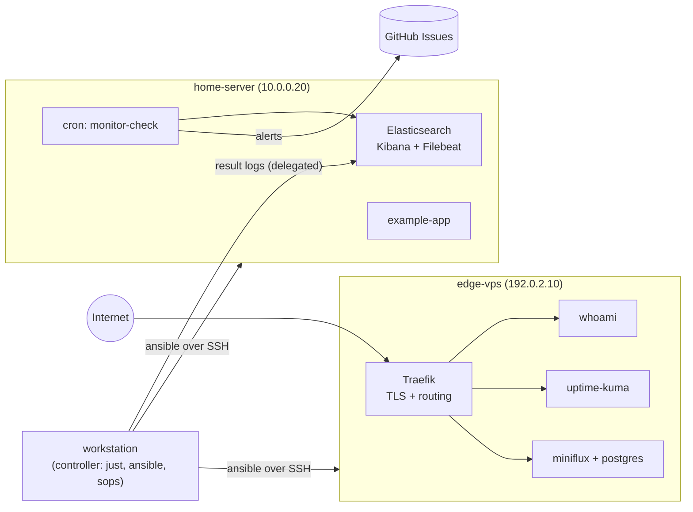
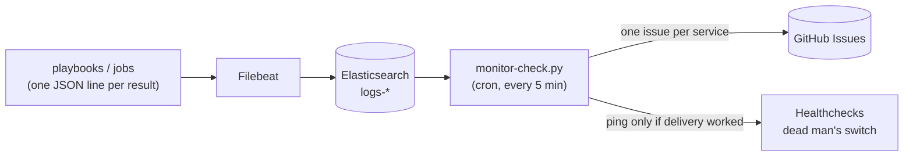

# iac-stack-template

Template for a small multi-host self-hosted platform: a public VPS, a home server and a workstation, managed from one repository with Ansible, with monitoring that opens GitHub Issues when something breaks and secrets that live in git only in encrypted form.

It is a starting point, not a finished product: fork it, replace the example hosts and services, delete what you do not need.

## The problem it addresses

A handful of machines and a dozen self-hosted services tend to end up as a pile of `ssh` sessions, hand-edited compose files and rules nobody remembers writing. The failures that hurt are quiet ones: a deploy that reports success while nothing changed, a job that crashes but shows green, an alert chain that works until the one day its token expires, a firewall nobody can read without logging in.

This template turns those into declarations and checks:

- **Which service runs where, and how it is deployed**, is one file (`services.yml`), validated against a schema and against contract rules before anything touches a host.
- **Deploys are roll-back-safe and measured.** The role snapshots, deploys, health-checks and rolls back; "changed" is derived from container IDs, never from grepping output.
- **Failures reach a human.** Jobs write structured result logs, Filebeat ships them to Elasticsearch, and `monitor-check.py` turns errors and missing heartbeats into GitHub Issues. If delivery itself breaks, the heartbeat to a dead man's switch is withheld, so the alert chain alerts about itself.
- **Secrets are encrypted at rest** (SOPS + age) and never exist as a plaintext file.

## Topology

The hosts below are the examples in `ansible/inventory/inventory.example.yml`. Addresses come from documentation ranges and are placeholders.



| Host | Group | Role in the example |
|---|---|---|
| `edge-vps` | `vps` | Public host: reverse proxy and the routed example services. Firewall declared in `group_vars/vps`. |
| `home-server` | `homelab` | Log host: Elasticsearch, Kibana, Filebeat, the alert loop, and one internal app. |
| `workstation` | `desktops` | Controller. Runs `just` and Ansible, holds the age key. |

## The alert chain



`monitor-check.py` keeps one open issue per service, labels it, and closes it after a quiet period (`RESOLVE_AFTER_HOURS`). It exits non-zero when it found an alert it could not file, which withholds the Healthchecks ping.

## What is automated

| Area | Where | What it does |
|---|---|---|
| Service deploy | `ansible/roles/service_deploy`, `ansible/playbooks/deploy.yml` | Eight steps: preflight, Traefik label collision check, snapshot, acquisition (`compose-pull`, `git-pull` or `rsync-build`), `.env`, compose up, health check, rollback on failure. |
| Service inventory | `services.yml`, `services.schema.json`, `scripts/validate_services.py` | One declaration per service. The validator enforces rules a schema cannot (no published port behind a domain, `sync:` coverage, domain collisions, secret references). |
| Firewall | `ansible/playbooks/runbooks/firewall.yml` | Converges UFW against `ufw_rules`. Refuses to run without an SSH rule, adds before deleting, verifies afterwards. |
| Docker log rotation | `ansible/playbooks/runbooks/docker_log_rotation.yml` | Writes `daemon.json`, reports how many running containers are still unbounded. The daemon restart is opt-in. |
| Monitoring stack | `ansible/playbooks/runbooks/monitoring_stack.yml`, `monitoring/` | Elasticsearch, Kibana, Filebeat, index template, and an ingest probe that proves the whole path. |
| Alert loop | `monitoring/scripts/monitor-check.py`, `runbooks/monitor_check_cron.yml` | Errors and missing heartbeats become GitHub Issues. |
| Health checks | `ansible/playbooks/checks/` | Connectivity, services, host config, cron. |
| Example job | `ansible/playbooks/jobs/http_check.yml` | The reference shape for a scheduled job: start ping, payload, result log, success/fail ping, crash guard. |
| Ansible tracing | `ansible/callback_plugins/es_logger.py` | Playbook runs emit job and task spans into Elasticsearch. A dry run is downgraded so it cannot open issues. |
| Secrets | `.sops.yaml`, `./j`, `ansible/lookup_plugins/sops_dotenv.py` | SOPS + age; values are decrypted into one process tree only. |
| Infrastructure | `terraform/` | Scaffold only (see Limits). |
| Tests | `ansible/scripts/tests`, `monitoring/scripts/tests`, `scripts/tests` | Structural tests that need no hosts: they read the YAML and pin the failure modes above. |

## Quick start (no hosts needed)

```bash
just test       # unit and structural tests
just validate   # services.yml against schema + contract rules
just syntax     # ansible syntax-check of every playbook (example inventory)
just lint       # ansible-lint
just status     # table of the example services
```

Prerequisites: [just](https://github.com/casey/just), [uv](https://docs.astral.sh/uv/), Ansible (`just init` installs `ansible-core` with uv), and for real use Docker, [sops](https://github.com/getsops/sops) and [age](https://github.com/FiloSottile/age). Terraform is optional.

## Adapting it to your environment

1. **Fork or copy** the repository and make it private if it will describe real infrastructure.
2. **Inventory.** Copy `ansible/inventory/inventory.example.yml` to `ansible/inventory/inventory.yml` (gitignored; the justfile prefers it automatically). Replace the example hosts. The example reads addresses and users from environment variables (`EDGE_VPS_HOST`, `EDGE_VPS_USER`, `HOME_SERVER_HOST`, ...) so the real values live in the encrypted secrets, not in git. Keep group names, or update `hosts:` in the runbooks.
3. **Secrets.** Follow `docs/secrets.md`: create an age key, put the public key into `.sops.yaml`, copy `secrets/example.env` to `secrets/app.env`, fill in your values and encrypt it. `just secrets-check` proves the machine can decrypt.
4. **Services.** Edit `services.yml`: set `domain_suffix` to a domain you control, delete the example services, add yours under `services/<name>/docker-compose.yml`. The `Host()` label in each compose file must carry the resolved domain. Run `just validate`.
5. **Traefik.** In `services/traefik/docker-compose.yml`, replace the Let's Encrypt contact address (`admin@example.com`). Deploy Traefik first, because the other stacks join its `proxy` network.
6. **Firewall and expected containers.** Adjust `ufw_rules` in `group_vars/vps/main.yml` and `expected_containers` per group. Run `just firewall-check` before `just firewall`.
7. **Monitoring.** Set `es_log_host` in `group_vars/all/main.yml`, deploy the stack with `./j monitoring-stack`, then the alert loop with `IAC_REPO_URL=<your repo> ./j monitor-check-cron`. Create a repository for the alerts and put `GITHUB_TOKEN`, `GITHUB_OWNER` and `GITHUB_REPO` into the secrets. Prove the chain with `just test-chain`.
8. **First deploy.** `./j deploy-check whoami` (dry run), then `./j deploy whoami`.
9. **Before pushing:** `gitleaks dir .` (config included).

Recipes that touch hosts run through `./j`, which decrypts the secrets into that command's environment only. Plain `just` has no secrets and the guard says so.

## Security model

- **Secrets at rest:** SOPS-encrypted dotenv with age; keys stay readable, values are `ENC[...]`. The age private key is never committed. A test fails if a non-example file under `secrets/` is plaintext.
- **Secrets in use:** `./j` decrypts into one process tree via `sops exec-env`; no plaintext file is written. Per-service `.env` files on hosts are rendered from the encrypted file (`env_from_secrets`) with mode `0600` and `no_log`. The reference grammar is an allowlist, because a free path would let an absolute path escape the repository.
- **Network exposure:** the validator rejects a published port next to a `domain:`, because Docker publishes ahead of UFW and around Traefik. The firewall is a declaration with a reason per rule; the runbook cannot remove the SSH rule.
- **Elasticsearch has no authentication in this template** (`xpack.security.enabled=false`) and binds to loopback by default. Do not bind it to an interface you do not control.
- **Deploy safety:** rollback never runs `compose down`, does nothing without a snapshot, and fails loudly afterwards.
- **No plaintext by accident:** `.gitignore` blocks `.env*`, `*.decrypted`, `*.plaintext` and your real inventory; `.gitleaks.toml` runs the default ruleset.

## Limits

- **Terraform is a scaffold.** `terraform/` declares no provider and no resource. There is no state backend.
- **Single-node, no authentication for the Elastic stack.** Fine for a small private platform behind loopback and SSH tunnels; not a hardened logging setup.
- **No scheduler.** Scheduled work is plain cron plus `just job <id>`. `monitoring/config/jobs.json` lists the example jobs and their suggested schedules; nothing installs them for you.
- **Healthchecks is optional but assumed** for the dead man's switch; without it the alert loop still works, it just cannot alert about itself.
- **Linux hosts are the tested shape** for the runbooks (UFW, systemd). `deploy_environment` exists for hosts with a minimal SSH `PATH`.
- **Example services are examples.** Pin image versions and review them before exposing anything.
- **Tested here:** the unit/structural tests, `ansible-playbook --syntax-check` and `ansible-lint`. Deploys, the firewall runbook and the monitoring stack need real hosts and are not exercised by this repository's checks.

## Layout

```text
ansible/            roles, playbooks (deploy, runbooks, checks, jobs), plugins, inventory, tests
monitoring/         Filebeat, local Elastic compose, monitor-check.py, job definitions
scripts/            validate_services.py, services.py, age-key.sh, iac_secrets.py, tests
secrets/            example.env (placeholders only); your encrypted app.env goes here
services/           one directory per service (compose file, sidecars)
terraform/          scaffold
docs/secrets.md     SOPS + age how-to
services.yml        service inventory (+ services.schema.json)
j, justfile         the entry points
```

## License

MIT, see `LICENSE`.
